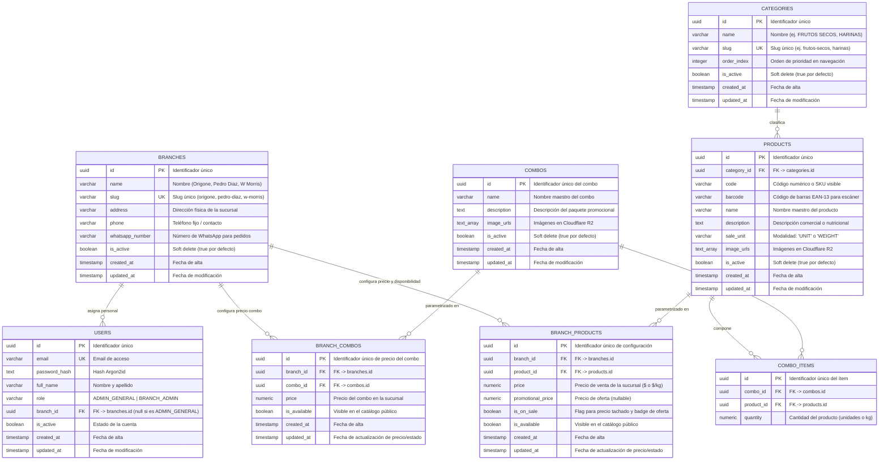

# Modelo Entidad-Relación (MER) — Nutrigon MVP

**Estado:** Aprobado y alineado con los contratos y semillas CSV  
**Fecha:** 15 de Octubre de 2026  
**Motor:** PostgreSQL 16 (Drizzle ORM)  

---

## 1. Diagrama Entidad-Relación (MER)

---

## 2. Restricciones de Integridad y Claves Únicas

1. **`BRANCH_PRODUCTS`:**
   - `UNIQUE(branch_id, product_id)`: Garantiza que un producto tenga una única configuración comercial por sucursal.
2. **`BRANCH_COMBOS`:**
   - `UNIQUE(branch_id, combo_id)`: Garantiza que un combo tenga un único precio y disponibilidad por sucursal.
3. **`CATEGORIES`:**
   - `UNIQUE(slug)`: Garantiza que las rutas web del catálogo (`/categoria/:slug`) sean unívocas.
4. **`BRANCHES`:**
   - `UNIQUE(slug)`: Garantiza que el acceso web por sucursal (`/sucursal/:slug`) sea determinista.
5. **`USERS`:**
   - `UNIQUE(email)`: Autenticación única.
6. **`PRODUCTS`:**
   - Índice sobre `code` y `barcode` para búsquedas instantáneas en el panel de administración y punto de venta.

---

## 3. Alineación con las Semillas CSV (`data/`)

| Tabla | Archivo Semilla | Cobertura |
|---|---|---|
| `branches` | `data/branches.csv` | 3 sucursales fundacionales: Origone, Pedro Diaz, W Morris |
| `categories` | `data/categories.csv` | 20 categorías normalizadas (Frutos Secos, Harinas, etc.) |
| `products` | `data/products.csv` | 2.257 productos maestros con código, nombre, categoría y modalidad (`UNIT` / `WEIGHT`) |
| `branch_products` | — | Se parametriza desde el panel de administración o seed inicial |
| `combos` / `combo_items` | — | Se administran desde el panel de administración |
| `users` | — | Seed de administradores iniciales con credenciales hash Argon2id |
