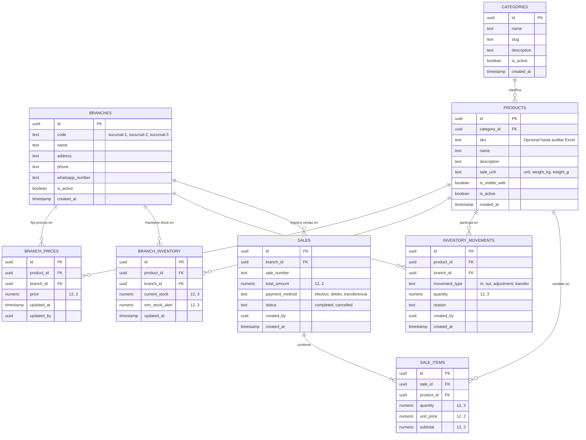

# Propuesta Preliminar del Modelo de Datos — Dietética (3 Sucursales)

> [!WARNING]
> **ESTADO DEL DOCUMENTO: BORRADOR PRELIMINAR DE VALIDACIÓN TÉCNICA**
> Este modelo de datos representa una propuesta de diseño para estructurar la separación entre catálogo maestro y las 3 sucursales. **NO ES EL MODELO FINAL DEFINITIVO**. Está sujeto a ajustes y validación técnica una vez analizados los archivos Excel reales y definidas las decisiones comerciales pendientes (D-01 a D-10).

---

## 1. Diagrama Entidad-Relación Conceptual

---

## 2. Descripción de Entidades

### 2.1. `branches` (Sucursales)
Representa los tres puntos de venta físicos del negocio. Permite asignar usuarios, segmentar precios, controlar existencias e indicar el número de WhatsApp comercial de cada una si la atención es descentralizada.

### 2.2. `categories` (Categorías)
Estructura taxonómica para organizar productos en el catálogo web y en el buscador administrativo (ej. Frutos Secos, Harinas, Suplementos, Especias).

### 2.3. `products` (Catálogo Maestro)
**Fuente única de verdad de los productos.** No se duplica por sucursal.
- `sale_unit`: define si se comercializa por unidad entera (`unit`), por kilogramo (`weight_kg`) o por gramos (`weight_g`).
- `is_visible_web`: flag para controlar qué productos se publican en el catálogo digital.

### 2.4. `branch_prices` (Precios Segregados)
Resuelve el requerimiento de precios diferenciados entre sucursales. Posee una restricción `UNIQUE (product_id, branch_id)` para asegurar un único precio activo por producto en cada sucursal.

### 2.5. `branch_inventory` (Existencias Segregadas)
Mantiene el balance de stock actual e indicador de alerta de reposición. Utiliza precisión de 3 decimales (`numeric(12, 3)`) para soportar fraccionamiento por peso.

### 2.6. `inventory_movements` (Auditoría de Movimientos)
Tabla histórica e inmutable. Registra cada ingreso, egreso, merma o ajuste manual con su responsable y justificación.

### 2.7. `sales` y `sale_items` (Ventas Administrativas)
Registro transaccional de ventas realizadas en mostrador. Permite vincular los ítems vendidos para consolidar reportes de venta por fecha y sucursal.

---

## 3. Matriz Preliminar de Seguridad y RLS

| Rol | Catálogo (`products`, `categories`) | Precios (`branch_prices`) | Inventario (`branch_inventory`) | Ventas (`sales`) |
| :--- | :--- | :--- | :--- | :--- |
| **Público (Anónimo Web)** | Solo lectura (`is_visible_web = true`) | Solo lectura de sucursal seleccionada | No visible (o solo indicador de disponibilidad) | Sin acceso |
| **Personal de Sucursal** | Lectura completa | Lectura de su sucursal | Lectura y ajustes de su sucursal | Registro y consulta de su sucursal |
| **Administrador General** | Lectura y Escritura total | Lectura y Escritura total | Lectura y Escritura total | Lectura y Reportes consolidados |

---

## 4. Preguntas Abiertas para Validación con el Cliente
1. ¿El SKU actual en las planillas Excel es único entre todas las sucursales o difiere?
2. Para productos por peso: ¿se cobrará siempre por 100g o por 1kg como precio base visible?
3. ¿Las anulaciones de venta reintegran el stock automáticamente mediante un movimiento compensatorio?
